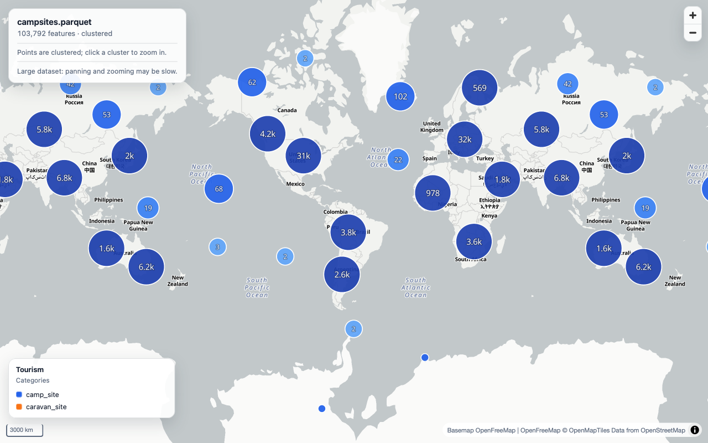

# geodataviewer for Tern



Preview vector geodata and GeoTIFF/COG imagery on an interactive map, inside Tern.

Open a GeoJSON, TopoJSON, KML, GPX, WKT, CSV, Shapefile, FlatGeobuf, GeoParquet,
GeoPackage or GeoTIFF/COG file and press
<kbd>Cmd</kbd>+<kbd>Shift</kbd>+<kbd>V</kbd> (or run **Preview geodata on a map** from
the command palette). A browser picture-in-picture opens over the file with the data
drawn on a [MapLibre GL JS](https://maplibre.org/) map. Click a vector feature to inspect
its properties. GeoTIFF/COG images are drawn as a georeferenced raster overlay.

The basemap is [OpenFreeMap](https://openfreemap.org/) (`positron` in light appearance,
`dark` in dark appearance). If OpenFreeMap cannot be reached, the features are still drawn
on a plain background and the page says so.

## Requirements

- Tern with plugin support (verified with Tern 0.9.8 on macOS).
- Node.js 18 or newer. The page generator runs in a child process so a large dataset
  never blocks Tern's window thread. Tern started from Finder/Dock often has a minimal
  `PATH`; the plugin searches `/opt/homebrew/bin`, `/usr/local/bin`, nvm, Volta, asdf,
  mise, fnm and common Windows locations. Set `TERN_GEODATAVIEWER_NODE` to override the
  executable.

## Install

For a checkout:

```sh
tern plugin link /path/to/geodataviewer-tern
```

From a repository:

```sh
tern plugin install github.com/beyoung/geodataviewer-tern
```

`tern plugin list` should show `geodataviewer ... window ready`.

## Usage

1. Open a supported file in Tern (a file block, or Tern's table view for CSV).
2. Press <kbd>Cmd</kbd>+<kbd>Shift</kbd>+<kbd>V</kbd>, or run **Preview geodata on a map**
   from the command palette (action `plugin.geodataviewer.preview`).
3. Click vector features to see their properties. Pan and zoom with the mouse.

The same command refreshes the map. Previewing another file in the same window reuses
the map pane and closes the previous one, so only one WebGL map is kept per window.

You can also select a geodata file in the Files pane and click the globe button
**Preview on a map** in its header.

To change the shortcut, bind `plugin.geodataviewer.preview` in Tern's keyboard settings
(the default chord is `cmd+shift+v`). Tern reserves that chord in its preset, so the
plugin installs it once as a user keybind; an existing binding you already chose for the
chord is left alone.

## Rendering

The page picks a style from the data instead of using one fixed color:

- Categorical fields such as `type`, `kind`, `class`, `zone` or `tourism` get a color
  legend and matching fill/line/point colors.
- Numeric fields such as population, value, count, area or height become a choropleth
  for polygons and lines, and a graded color/size scale for points.
- Datasets without a useful field keep a restrained default style.
- Point layers above 4,000 features are clustered by MapLibre; click a cluster to zoom in.
  Smaller point layers with a `name`/`title` field get collision-aware labels.
- Single-band GeoTIFF/COG rasters use a Viridis color ramp with a value legend; RGB
  imagery keeps its colors. Rasters are downsampled to preview size.
- A compact legend, layer toggles, feature popups and the basemap follow the light/dark
  appearance.

## Supported formats

| Format | Extensions | Notes |
| --- | --- | --- |
| GeoJSON | `.geojson`, `.json` | Feature, FeatureCollection, geometry or GeoJSON-in-JSON |
| TopoJSON | `.topojson`, `.json` | Topology objects are converted with `topojson-client` |
| KML | `.kml` | Converted with `@tmcw/togeojson` |
| GPX | `.gpx` | Tracks, routes and waypoints |
| WKT | `.wkt` | `POINT`, `LINESTRING`, `POLYGON`, `MULTI*`, `GEOMETRYCOLLECTION`; one or more per file |
| CSV / TSV | `.csv`, `.tsv` | Columns named like `lat`/`latitude` and `lon`/`lng`/`longitude`, or a WKT/geometry column |
| Shapefile | `.shp` | Reads sibling `.dbf`, `.prj` and `.cpg` (case-insensitive) |
| FlatGeobuf | `.fgb` | Whole-file deserialization |
| GeoParquet | `.parquet`, `.geoparquet` | WKB geometry, GeoParquet metadata, CRS84/EPSG reprojection when supported |
| GeoPackage | `.gpkg` | Vector feature layers, multiple layers with per-layer toggles; raster tile layers are not supported yet |
| GeoTIFF / COG | `.tif`, `.tiff`, `.cog` | Local files; downsample to 1600 px, contrast stretch, JPEG/YCbCr to RGB, band 1 grayscale |
| Text | `.txt` | Content sniffing for GeoJSON, KML, GPX or WKT |

Coordinates are expected in WGS84 longitude/latitude. Shapefile `.prj`, GeoPackage
`gpkg_spatial_ref_sys`, GeoParquet CRS metadata and GeoTIFF EPSG codes are reprojected
when the CRS is known (EPSG:4326, EPSG:3857 and UTM zones are built in). An unknown CRS
is shown as-is with a notice.

GeoParquet and GeoPackage are read in the Node generator, not in the browser, so their
feature tables do not block Tern's window thread. GeoTIFF/COG is decoded and encoded to
a PNG in the same generator; the page only receives the resulting image and bounds.

## Limits

- Text formats: 64 MiB per file; Shapefile/FlatGeobuf: 128 MiB; GeoParquet/GeoPackage:
  256 MiB; GeoTIFF/COG: 512 MiB.
- Vector features are parsed in the browser; above 50,000 features panning and zooming
  may be slow and the page shows a warning. GeoParquet/GeoPackage are capped at 200,000
  features per preview.
- GeoTIFF/COG rasters are downsampled to at most 1600 px on the longest side. Multi-band
  rasters show bands 1-3; single-band rasters use a grayscale stretch. JP2, HDF and
  NetCDF are not supported.
- Local files only. A file on a remote host is refused with a notice for now.
- The preview reads the file on disk. Save a file block's edits before previewing.
- The basemap needs network access. Features still render without it.

## Development

Layout:

- `window.luau` — palette command, shortcut, Files pane button.
- `lib/detect.luau` — extension map and user-facing format names.
- `lib/preview.luau` — target discovery, one-map-per-window reuse, Node generator call.
- `scripts/make_preview.mjs` — reads the dataset, embeds it, writes one HTML page.
- `scripts/sources/vector.mjs` — GeoParquet and GeoPackage readers (bundled to
  `scripts/vendor/vector.cjs`).
- `scripts/sources/raster.mjs` — GeoTIFF/COG reader and PNG encoder (bundled to
  `scripts/vendor/raster.cjs`).
- `scripts/build_vendor.mjs` — rebuilds the bundled readers and copies their WASM files.
- `assets/app.js`, `assets/app.css` — MapLibre page: parsing, layers, popups, HUD.
- `assets/vendor/` — vendored MapLibre GL JS, topojson-client, togeojson, shpjs and
  flatgeobuf; `scripts/vendor/` holds the bundled Node readers and their WASM files.
- `tests/fixtures/` — small GeoJSON, KML, GPX, WKT and CSV samples.

Type definitions:

```sh
tern plugin types .
```

This writes `tern.d.luau`, which is ignored by git.

Smoke test with the fixtures:

```sh
node scripts/make_preview.mjs tests/fixtures/sample.geojson . /tmp/geodataviewer-preview test
```

Open the reported `file://` URL in Tern with `tern browser` or a browser pane. Saving a
file in a linked plugin folder makes Tern reload the plugin.

Rebuilding the Node readers after changing `scripts/sources/`:

```sh
npm install
npm run build:vendor
```

The generated bundles and WASM files are committed, so installing the plugin from Tern
does not run npm.

## License

MIT. See `LICENSE`. Browser libraries keep their licenses in
`assets/vendor/LICENSE-*.txt`; the bundled Node readers keep theirs in
`scripts/vendor/licenses/`. Versions and sources are listed in
`assets/vendor/THIRD_PARTY.md` and `scripts/vendor/THIRD_PARTY.md`.
